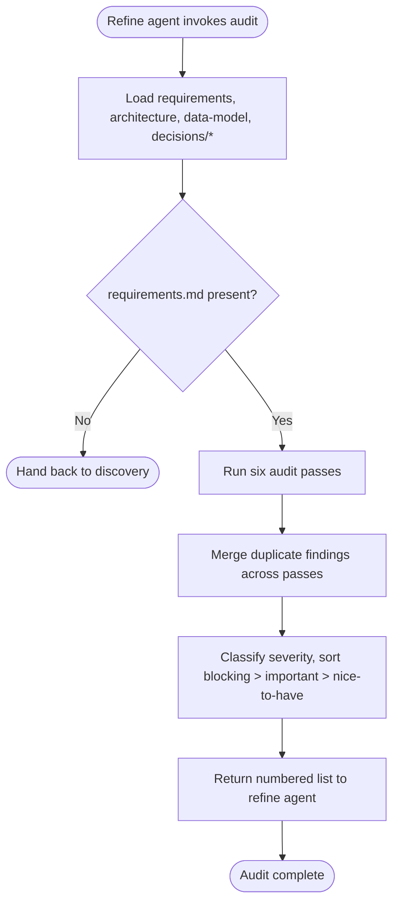

# Audit Docs

Phase A of the refine flow. Read the current doc set and return a ranked, numbered list of findings. Read-only. No file is created or modified by this skill.

## Preconditions

- `requirements.md` exists in the slug root. If missing, stop and hand back to the `discovery` agent.
- `architecture.md`, `data-model.md`, and `decisions/*.md` are read if present. Absent files are treated as findings themselves ("architecture.md missing" is a blocking finding when at least one initiative names components).

## Guiding principles

- **Read-only.** Never edit, create, or delete a file in this skill. The output is a list, nothing else.
- **Content over prose.** Audit content gaps and cross-doc consistency. Do not flag em-dash usage, sentence-per-line violations, or other prose-quality nits.
- **Rank, do not fix.** Attach a severity and a one-line rationale to every finding. Do not propose the resolution here - that is the refine phase's job.
- **Cross-reference IDs strictly.** Initiative IDs (`I1`, `I2`, ...), access-pattern IDs (`AP1`, ...), ADR IDs (`ADR-0003`, or the file's leading number) are the currency of the doc set. Any ID cited that resolves to nothing is a blocking finding.
- **Do not double-count.** If the same underlying issue surfaces in two passes (e.g. missing component AND missing access pattern for the same initiative), report it once with all touched files listed.

## Audit passes

Run all six passes over the loaded doc set:

1. **Open questions.** Every unresolved item in each doc's `## Open questions` section becomes a finding. Include its `Owner` if named; flag `Owner: -` as a nice-to-have side-finding.
2. **Cross-doc reference integrity.** Initiative IDs cited in `architecture.md` component table exist in `requirements.md`. Access-pattern IDs cited in `data-model.md` exist in the same doc. ADR `Related` links resolve to existing ADR files. `Superseded by NNNN` targets an existing ADR.
3. **Stack lock consistency.** The chosen stack in `architecture.md` section 2 matches any stack claim made in `data-model.md` (storage choice) and in ADR context sections. A mismatch is a blocking finding.
4. **Storage alignment.** The stores named in `architecture.md` section 2 (PostgreSQL / MongoDB / DynamoDB / SQS / SNS / Kafka) are the same set of stores addressed in `data-model.md`. A store named in one doc but silent in the other is a finding.
5. **Status and date freshness.** Any doc with `Status: draft` while a downstream doc is `Status: approved` is a nice-to-have finding ("upstream doc lagging"). Any doc whose `Last updated` is older than a resolved open question in the same doc is a nice-to-have finding ("date drift").
6. **ADR coverage.** Every entry in `architecture.md` section 7 "Decisions requiring ADR" and every equivalent list in `data-model.md` maps to an ADR file under `decisions/`. Uncovered entries are important findings.

## Severity heuristic

- **Blocking**: initiative in `requirements.md` with no component in `architecture.md`; storage claim in `architecture.md` differs from `data-model.md`; dangling cross-doc ID reference; `Superseded by X` where X does not exist; access pattern with no store named for it.
- **Important**: unresolved `## Open questions` item older than the doc's `Last updated`; "Decisions requiring ADR" entry with no matching ADR file; stack row `<or deviation + why>` still unfilled; access pattern with no PK/SK or index serving it.
- **Nice-to-have**: `Status: draft` on a doc whose downstream doc is `approved`; missing `Owner` on an open question; date drift where `Last updated` predates a change log entry in the same doc.

## Flow



## Output format

Return the findings as a numbered Markdown list. Each finding is one row:

```markdown
## Audit findings

Total: N (blocking: X, important: Y, nice-to-have: Z)

1. **[blocking]** <one-line rationale>. Files: `requirements.md`, `architecture.md`.
2. **[blocking]** <one-line rationale>. Files: `architecture.md`, `data-model.md`.
3. **[important]** <one-line rationale>. Files: `data-model.md`, `decisions/`.
4. **[important]** <one-line rationale>. Files: `architecture.md`.
5. **[nice-to-have]** <one-line rationale>. Files: `requirements.md`.
```

Rules for the output:

- Numbered top-down by severity, then by pass order within a severity.
- Each rationale is a single line, plain sentence, no jargon the user has not seen in the docs.
- `Files:` lists every file the finding touches. This is the set `refine-docs` will target if the user picks this finding.
- If no findings are found, output `## Audit findings\n\nDoc set is clean. Nothing to refine.` and stop.

## Rules for this skill

- Never edit or create a file.
- Do NOT propose fixes in the audit output. The user picks a finding, then the refine agent runs the grill phase.
- Do NOT flag prose-quality issues (em dash, sentence-per-line, ordering, wording).
- If an unrecognized file appears in the slug root (e.g. `notes.md`), ignore it. Only the canonical files and `decisions/*.md` are in scope.
- If a doc has no `## Open questions` section at all, that itself is a nice-to-have finding ("section missing").

## Handoff to the refine agent

Return the numbered list to the refine agent, which will present it to the user for selection. Do not proceed to any grill or write step from within this skill.
