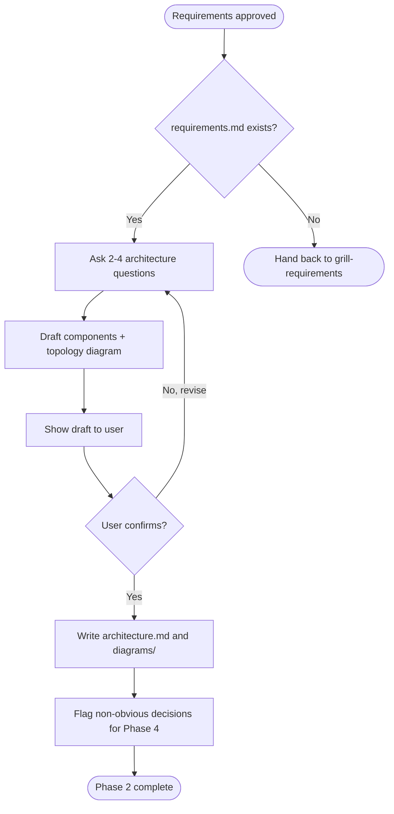

# Draft Architecture

Phase 2 of the discovery flow. Turn approved requirements into an `architecture.md` with a clear component decomposition and topology diagram.

## Preconditions

- `requirements.md` exists and is marked `approved` or the user has explicitly said "let's move on".
- If either is missing, stop and hand back to `grill-requirements`.

## Guiding principles

- **Requirements drive components, not the other way around.** Every component you introduce must map to at least one initiative in `requirements.md`. If a component has no mapped initiative, remove it or challenge the requirement.
- **Default stack first.** Frame the proposal around Java + Spring Boot + Postgres / NoSQL + AWS. Only deviate if the idea genuinely does not fit, and justify the deviation in text.
- **Storage choice is a decision, not an assumption.** For each persistent thing, state whether it's relational or NoSQL and why. If NoSQL, distinguish document (MongoDB) vs. key-value / wide-column (DynamoDB) by access pattern.
- **Diagrams first.** Lead each section with a diagram, then explain in prose.
- **No code.** Discuss interfaces at the level of "REST", "async queue", "S3 event", not method signatures.
- **Define jargon on first use.** The first time a session mentions a term the user has not used themselves, add a one-line plain-English gloss in parentheses. Examples: "Spring MVC (the servlet-based, blocking web layer)", "WebFlux (Spring's reactive/non-blocking alternative)", "outbox pattern (write events to a DB table so a separate publisher can ship them reliably)", "SigV4 (AWS request-signing scheme)", "GSI (Global Secondary Index - a DynamoDB alternate-key index)", "partial index (a Postgres index that only covers rows matching a WHERE clause)". Skip the gloss only when the user has already used the term in their own writing. When in doubt, gloss.

## Diagram policy

| Diagram type | Tool |
| --- | --- |
| Component / logical | Mermaid `flowchart` or `graph` |
| Sequence / interaction | Mermaid `sequenceDiagram` |
| ER / data relationships | Mermaid `erDiagram` (also used by `draft-data-model`) |
| Cloud / infra topology | mingrammer/diagrams (Python) |

Lock the choice per diagram type at first use in the project. Do not mix.

### Using mingrammer/diagrams

Before writing any `.py` diagram source:

1. Check toolchain: `python3 --version`, `dot -V`.
2. If either is missing, stop and ask the user to install:
   - `brew install graphviz`
   - `pip3 install diagrams`
3. **Discover the Python environment.** Before running any `python`, `ls` the project root for `venv/`, `.venv/`, `env/`, `.env/`. If exactly one is found, propose using `<name>/bin/python` and confirm with the user. If multiple are found, list them and ask. If none, ask whether to use system `python3` or create a venv. Never guess the venv name.
4. Do NOT install anything yourself.

Diagram files go in `<cwd>/<slug>/diagrams/`. Commit both `.py` source and rendered `.png`. Regeneration command goes in a comment at the top of each `.py`.

**Embed rendered diagrams inline in `architecture.md`.** After rendering, reference the PNG with Markdown image syntax so it displays inside the document, not just as a link:

```markdown


*Source: [`diagrams/topology.py`](./diagrams/topology.py) - regenerate with `python diagrams/topology.py`.*
```

Every rendered diagram must appear inline in the section it belongs to. The `.py` source is linked below the image, not in place of it. Never reference a topology image only by link.

## Question dimensions (before drafting)

Ask the user 2-4 questions per turn until each is resolved.

**Hard cap: 4 items per turn, counting sub-items.** A question with lettered sub-options (a, b, c, ...) is NOT one question - it is one per sub-item. Count every "or" and every bullet. If a turn would exceed 4 items, split into `Batch N/M` turns and stop after each batch. This applies to the dimensions list below - do NOT ask about 3 dimensions with 2 sub-options each in the same turn.

Dimensions to work through:

1. **Deployment target** - AWS region(s), single-region or multi-region, on-prem constraints.
2. **Interface style** - REST, GraphQL, gRPC, event-driven, mix? Sync vs. async boundaries.
3. **Auth model** - Who authenticates? Which service? SSO / OAuth / API keys / mTLS?
4. **Persistence per bounded context** - For each initiative, what needs to be stored, how is it queried?
5. **Async / eventing needs** - Any workflows that must be non-blocking, retryable, or fanned out?
6. **Existing systems to reuse** - Anything already in place we should not rebuild?
7. **Operational constraints** - Deployment cadence, blue/green vs. rolling, on-call model.

## Flow



## Output format

Write `architecture.md` with this structure:

```markdown
# Architecture: <project name>

**Status**: draft | in-review | approved
**Requirements ref**: [requirements.md](./requirements.md)
**Last updated**: <YYYY-MM-DD>

## 1. Context

<2-4 sentences summarizing the problem from requirements.md and what this architecture optimizes for.>

## 2. Chosen stack

| Layer | Choice | Rationale |
| --- | --- | --- |
| Language / framework | Java + Spring Boot | <or deviation + why> |
| Relational store | PostgreSQL | <or "none" + why> |
| NoSQL store | MongoDB / DynamoDB / none | <access pattern justification> |
| Async / messaging | SQS / SNS / Kafka / none | <why> |
| Infra | AWS - <services list> | <why AWS regions / services> |

## 3. Component decomposition

<Mermaid component/flowchart diagram here.>

| Component | Responsibility | Owns storage? | Interfaces |
| --- | --- | --- | --- |
| <name> | <one-line responsibility> | yes/no - <which> | REST / async / etc. |

Each row must reference which initiative(s) from requirements.md it satisfies (e.g. "I1, I3").

## 4. Deployment topology


*Source: [`diagrams/topology.py`](./diagrams/topology.py) - regenerate with `python diagrams/topology.py`.*

Prose walking through the topology: what runs where, network boundaries, data flows.

## 5. Key flows

For each user-facing initiative, a Mermaid `sequenceDiagram` showing the components involved and the order of calls.

## 6. Cross-cutting concerns

Short subsections (2-4 sentences each) covering:
- Authentication & authorization
- Observability (logs, metrics, traces)
- Error handling & retries
- Security posture

## 7. Decisions requiring ADR

Numbered list of non-obvious choices that warrant a Phase 4 ADR. For each, one line naming the decision and one line naming the main alternative that was rejected.

## 8. Open questions

Anything that could not be resolved during this phase. Each item names who owns resolving it.
```

## Rules for this skill

- Do NOT invent components that have no initiative behind them.
- Do NOT specify library versions, ports, or exact IAM policies - those are implementation details for later.
- Do NOT commit to a NoSQL store without explicitly stating the access pattern that justifies it.
- If the user pushes to skip requirements, refuse and hand back to `grill-requirements`.
- Track open questions - it is better to ship an architecture with 3 flagged unknowns than 3 silent assumptions.

## Grill-only mode (invoked by the refine agent)

When the `refine` agent invokes this skill in grill-only mode, the caller names one specific dimension from the `Question dimensions` list above (e.g. "re-grill dimension 3: Auth model"). In that mode:

- Only re-open the named dimension. Do NOT re-grill the full list or re-draft the architecture.
- Apply the same "2-4 questions per turn, hard cap 4 items" rule.
- Stop after the dimension is resolved and return the resolved delta to the refine agent.
- Do NOT persist any file, do NOT rebuild diagrams. `refine-docs` is the single writer against existing docs.

## Handoff to Phase 3

When `architecture.md` is persisted, tell the user which entities and persistent stores need their data model detailed next. Then hand control back to the orchestrator so it can invoke `draft-data-model`.
