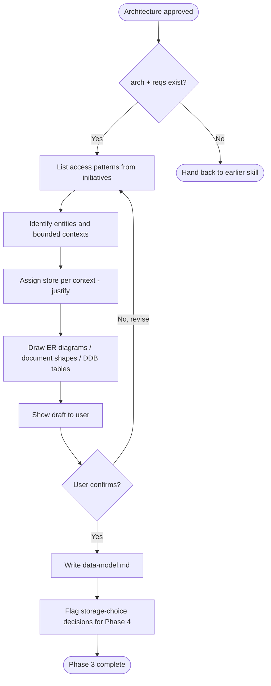

# Draft Data Model

Phase 3 of the discovery flow. Turn the approved architecture into a `data-model.md` that fully specifies entities, relationships, access patterns, and storage justification.

## Preconditions

- `requirements.md` and `architecture.md` exist and are approved (or the user has said "let's move on").
- If either is missing, stop and hand back to the appropriate earlier skill.

## Guiding principles

- **Access patterns drive the schema, not the reverse.** Before drawing a single entity, list every read and write the system needs to perform. Then design the storage that makes those cheap.
- **Storage per bounded context.** A system can have both relational and NoSQL stores. Each bounded context justifies its choice independently.
- **NoSQL is not "schemaless".** For MongoDB, document shape must be specified. For DynamoDB, PK/SK and every GSI must be specified against a named access pattern.
- **Normalize by default in relational stores.** Denormalize only when a specific access pattern demands it, and record that trade-off.
- **No implementation details.** No column types beyond conceptual ("string", "timestamp", "money"), no indexes beyond the ones needed for stated access patterns, no ORM annotations.

## Flow



## Access-pattern-first method

Before drawing anything:

1. Walk every initiative in `requirements.md` and every flow in `architecture.md`.
2. Extract each **read** and **write** as a row in an access-pattern table:

   | # | Operation | Trigger | Frequency | Latency budget |
   | --- | --- | --- | --- | --- |
   | AP1 | Get user by email | Login flow | High | < 50ms |
   | AP2 | List orders for user, newest first | Dashboard | Medium | < 200ms |
   | AP3 | ... | | | |

3. Group operations by bounded context.
4. For each context, pick the storage that makes the required patterns cheap.
5. Only then draw the schema.

## Storage selection guide

Use this as a starting heuristic, then justify per context:

| Signal | Suggested store |
| --- | --- |
| Multi-entity joins, ad-hoc queries, transactional invariants | PostgreSQL |
| Document-shaped, nested aggregates, flexible schema, moderate scale | MongoDB |
| Predictable access by known key, single-digit ms at scale, high write throughput | DynamoDB |
| Full-text search, faceted filtering | OpenSearch (mention only if flagged) |
| Analytical / OLAP | Redshift / Athena (mention only if flagged) |

## Output format

Write `data-model.md` with this structure:

```markdown
# Data Model: <project name>

**Status**: draft | in-review | approved
**Requirements ref**: [requirements.md](./requirements.md)
**Architecture ref**: [architecture.md](./architecture.md)
**Last updated**: <YYYY-MM-DD>

## 1. Access patterns

| # | Operation | Bounded context | Store | Frequency | Latency budget |
| --- | --- | --- | --- | --- | --- |
| AP1 | ... | | | | |

## 2. Bounded contexts

For each context, one subsection:

### 2.1 <Context name>

**Store**: PostgreSQL / MongoDB / DynamoDB
**Rationale**: <2-3 sentences tying access patterns above to the store choice.>

#### Entities

<Mermaid erDiagram for relational, or document shape / DDB table spec for NoSQL.>

**For relational (Postgres)**:

Mermaid `erDiagram` showing entities, PK, FKs, cardinality. Then a per-entity table:

| Entity | Field | Type | Constraints | Notes |
| --- | --- | --- | --- | --- |

**For MongoDB**:

Per collection, show the document shape as a fenced JSON block. State which fields are indexed and which access patterns each index serves.

**For DynamoDB**:

| Table | PK | SK | Attributes | Access patterns served |
| --- | --- | --- | --- | --- |

| GSI | PK | SK | Access patterns served |
| --- | --- | --- | --- |

## 3. Cross-context references

How data in one context refers to data in another (usually by ID, sometimes via events). Note any eventual-consistency implications.

## 4. Data lifecycle

For each entity: creation trigger, mutation triggers, deletion / soft-delete / archival policy, retention.

## 5. Decisions requiring ADR

Numbered list of non-obvious storage or modeling choices. Each item: decision + rejected alternative in one line each.

## 6. Open questions

Anything unresolved. Each item names the owner.
```

## Rules for this skill

- Do NOT design a schema before the access-pattern table exists.
- Do NOT introduce a store that is not already named in `architecture.md`, unless the user agrees to update the architecture first.
- Do NOT specify database-vendor-specific features (JSONB gymnastics, DynamoDB streams to Kinesis) unless a stated access pattern demands them.
- For DynamoDB designs, always verify every access pattern in the table has at least one PK/SK or GSI that serves it. Missing coverage = design bug.
- If the user pushes to skip access patterns, refuse - it is the whole point of this phase.
- **Do NOT design two stores in full.** If `architecture.md` deferred the store choice (e.g. "Postgres or DynamoDB, to be decided in Phase 3"), pick the **leading candidate** based on the access patterns and design only that one in full. Note the alternative in a single paragraph under §2 with a one-line summary of what would be different. The full side-by-side comparison belongs in a Phase 4 ADR, not in this document. Producing complete schemas for both stores makes the data-model unreadable and pushes the choice back onto the user during review.

## Grill-only mode (invoked by the refine agent)

When the `refine` agent invokes this skill in grill-only mode, the caller names one specific concern (e.g. "re-grill access pattern AP3", "re-grill data lifecycle for entity X"). In that mode:

- Only re-open the named concern. Do NOT re-grill the full data model or re-draft the whole doc.
- Apply the same "2-4 questions per turn, hard cap 4 items" rule.
- Stop after the concern is resolved and return the resolved delta to the refine agent.
- Do NOT persist any file. `refine-docs` is the single writer against existing docs.

## Handoff to Phase 4

When `data-model.md` is persisted, collect the "Decisions requiring ADR" lists from both `architecture.md` and this file. Show the combined list to the user and ask which ones they want to formally record. Then hand control back to the orchestrator so it can invoke `write-adr` once per chosen decision.
