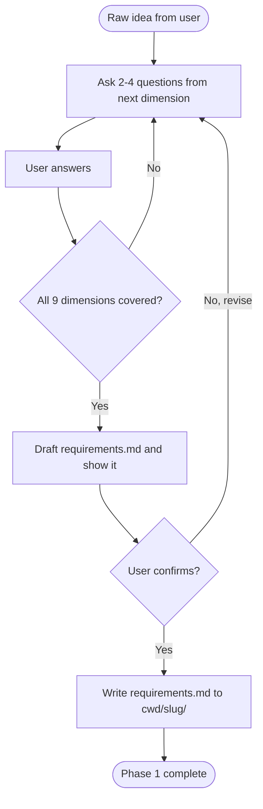

# Grill Requirements

Phase 1 of the discovery flow. Transform a raw idea into an unambiguous `requirements.md`.

## Guiding principles

- **KISS is the default.** Bias every question, every drafted initiative, and every acceptance criterion toward the simplest thing that could work. Complexity has to be *earned* by an explicit user need - not assumed, not "just in case", not "we might need it later". If the user has not asked for it, it is out of scope.
- **Small batches of questions.** Ask 2-4 focused questions per turn. Do not fire a 20-question interrogation.
- **Hard cap: 4 items per turn, counting sub-items.** A question with 10 lettered sub-options (a, b, c, ...) is NOT one question - it is ten. Count every sub-item, every bullet, every "or". If a turn would exceed 4 items, split into `Batch N/M` turns and stop after each batch to wait for the user. Nested lists that add up past 4 are the single most common way this skill fails.
- **High signal only.** Every question must eliminate an ambiguity that would otherwise force you to guess. If you already know the answer from context, do not ask.
- **Surface assumptions as questions.** If you catch yourself about to write "the system probably needs X", stop and ask instead.
- **No solutions yet.** Do not propose stack, architecture, or storage during this phase. If the user drags you there, note it and steer back.

## KISS in practice

Concrete rules that flow from the KISS bias:

- **Do not invent initiatives.** If the user described 3 things the system must do, the requirements have 3 initiatives - not 7. Never pad with "nice to haves" the user did not raise.
- **Push back on scope creep.** When the user proposes something that seems to expand scope, ask "is this needed for the first useful version, or can it wait?". Move deferrable items to a `Later` list, not into initiatives.
- **Prefer boring answers.** For non-functional requirements, if the user says "not sure", suggest the *minimum viable* number (e.g. "99% availability, single region, no HA") and let them raise the bar if they need to. Do not default to enterprise-grade numbers.
- **No premature integrations.** An integration goes on the list only if an initiative explicitly needs it. "We might integrate with X someday" belongs in Open Questions, not the Integrations table.
- **No premature compliance.** Do not add GDPR / LGPD / PCI / SOC2 rows unless the user names the constraint or the data class obviously triggers it (payments, health records, EU PII). Ask, do not assume.
- **Question the shape.** If the user asks for a distributed / event-driven / microservices / multi-tenant system out of the gate, ask what forces that shape. Fine if there is a real reason. Not fine if it is aesthetic.
- **One product, one loop.** Requirements describe one system doing one job well. If the idea has two products in it, name both and ask the user which is Phase 1.

## Question dimensions to cover

Work through these dimensions until each has a concrete answer. Skip a dimension only if the user's idea makes it inapplicable (state that explicitly).

1. **Problem & audience** - What problem does this solve, for whom, and why does the current situation hurt?
2. **Core initiatives** - What are the 3-7 primary things the system must let users do? (These become the numbered requirements.)
3. **Success criteria** - How does the user know each initiative is working? Quantify where possible.
4. **Scale & load** - Expected users, request rate, data volume, growth curve. Ballpark is fine.
5. **Data lifecycle** - What data is created, updated, deleted? Retention? Compliance constraints (GDPR, LGPD, PCI)?
6. **Integrations** - What external systems does it talk to? Which are read vs. write? Auth mechanism?
7. **Non-functional constraints** - Latency, availability, cost ceiling, deployment cadence, offline/online.
8. **Out of scope** - What is explicitly NOT this system's job? (This is as important as what IS.)
9. **Unknowns** - What is the user unsure about? Track these separately from requirements.

## Flow



## Output format

Write `requirements.md` with this structure:

```markdown
# Requirements: <project name>

**Status**: draft | in-review | approved
**Owner**: <user's name or handle if provided>
**Last updated**: <YYYY-MM-DD>

## 1. Problem statement

<2-4 sentences: what problem, for whom, why now.>

## 2. Initiatives

Numbered list. Each initiative is a capability the system must provide.

### I1. <Short imperative title>
**As a** <role> **I want** <capability> **so that** <benefit>.
**Acceptance criteria**:
- <criterion 1 - observable / testable>
- <criterion 2>

### I2. ...

## 3. Non-functional requirements

| Category | Requirement | Rationale |
| --- | --- | --- |
| Latency | <e.g. p95 < 300ms for read endpoints> | <why> |
| Availability | <e.g. 99.5%> | <why> |
| Scale | <users / rps / data volume> | <why> |
| Compliance | <GDPR / LGPD / PCI / none> | <why> |

## 4. Integrations

| System | Direction | Auth | Notes |
| --- | --- | --- | --- |
| <name> | read / write / both | <mechanism> | <notes> |

## 5. Out of scope

Bullet list of things this system explicitly does NOT do. Be specific.

## 6. Open questions

Bullet list of unknowns that need to be resolved before or during architecture phase.
Each item should name who owns resolving it.
```

## Fatigue signals

Watch for signs the user is disengaging. Any of these is a signal:

- One-word replies: "ok", "yes", "approve", "sure", "whatever".
- "You decide" / "just draft it" / "pick something reasonable".
- "Give me the question again" / "what was I answering?" (context is blown).
- "This is hard to follow" / "I don't know" / "I'm lost".

When you see any of these, stop the current line of questioning and:

1. **Recap in 3 lines**: what you have learned so far, what phase you're in, what decision is on the table right now.
2. **Collapse remaining questions to defaults.** For each open question, propose the KISS default in one line ("default: X because Y"). Bundle them under an `approve all` shortcut so the user can accept the whole set with one word.
3. Do NOT open new dimensions until the user has explicitly re-engaged.

## Rules for this skill

- Apply the **KISS bias** to every draft. If you find yourself adding an initiative, integration, NFR, or entity the user did not raise, delete it or turn it into an Open Question.
- Do NOT propose a technical stack in this phase. If the user asks, defer with "we'll cover that in Phase 2 (architecture)".
- Do NOT create the folder or write the file until the user has confirmed the full drafted requirements.
- Do NOT number initiatives before the user has agreed to the full set - renumbering later is annoying.
- If the user says "just draft it and I'll edit", still produce the draft, but flag which sections are pure inference so they know where to look.
- Track open questions aggressively - it is better to ship a requirements.md with 5 open questions than to silently guess 5 answers.

## Grill-only mode (invoked by the refine agent)

When the `refine` agent invokes this skill in grill-only mode, the caller names one specific dimension from the list above (e.g. "re-grill dimension 4: Scale & load"). In that mode:

- Only re-open the named dimension. Do NOT re-grill the full list.
- Apply the same "2-4 questions per turn, hard cap 4 items" rule.
- Stop after the dimension is resolved and return the resolved delta to the refine agent.
- Do NOT persist any file. `refine-docs` is the single writer against existing docs.

## Handoff to Phase 2

When `requirements.md` is persisted, summarize in 3 lines what the next phase (`draft-architecture`) will need from the user (typically: preferred deployment target, hard constraints on data residency, existing systems to integrate with). Then hand control back to the orchestrator.
