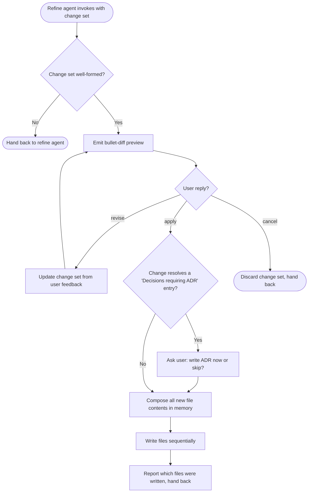

# Refine Docs

Phase C of the refine flow. Take an agreed refinement, preview it as a bullet diff across every affected file, wait for explicit `apply`, then write all files sequentially. Single writer against the existing doc set.

## Preconditions

- The refine agent has already run `audit-docs` and let the user pick a finding.
- Phase B (grill) has already resolved the delta with the user - concrete facts, not open questions.
- The change set is defined: which files change, which sections in each file, what the new content is.
- If any of the above is missing, refuse and hand back to the refine agent.

## Guiding principles

- **Preview then write.** Every session goes through the preview gate. Never skip it, even for a one-line edit.
- **Bullet diff, not prose.** The preview is a compact bullet list per file, not a full new draft. Users approve intent, not wording.
- **One finding, one preview.** Do not bundle multiple audit findings into a single preview. Loop back to the refine agent for the next finding.
- **All or nothing per file.** Compose the new content of each file in memory in full, then write. Do not do partial in-place patches that leave a file half-updated on failure.
- **Best-effort atomicity.** Stage all new file contents in memory, then write them sequentially. On any I/O failure, stop and report which files were written and which remain pending. No rollback.
- **Preserve the doc format.** Every touched file keeps its existing section order, headings, IDs, and status/date lines. The only structural additions this skill introduces are:
  - Removal of resolved items from `## Open questions`.
  - A `## Change log` section at the bottom of the file (created on first refinement).
  - A bumped `**Last updated**` value; a bumped `**Status**` only if the change moves the doc's maturity.

## The bullet-diff preview

Emit the preview under an H2 heading in your reply to the user. Do not write anything to disk yet.

```markdown
## Proposed changes

Finding: #N - <one-line summary>

**requirements.md**
- update section `## 2. Initiatives`: add I5 for `<capability>`; acceptance criterion `<criterion>`.
- remove from `## 6. Open questions`: `<the resolved question>`.
- append to `## Change log`: `YYYY-MM-DD - added I5 - resolves: #N`.

**architecture.md**
- update section `## 3. Component decomposition`: add row `<component>` mapped to I5.
- append to `## Change log`: `YYYY-MM-DD - added component for I5 - resolves: #N`.

Reply `apply` to write, `revise` to change the plan, `cancel` to abort.
```

Rules for the bullet diff:

- One bullet per touched section per file.
- Each bullet uses `add | update | remove` as its verb.
- Each bullet describes the change in <= 15 words. If a change genuinely needs more, split it into multiple bullets.
- Every file that will be written appears in the preview, even if its only change is the `Last updated` bump and Change log entry.
- The final line always states the three valid replies: `apply`, `revise`, `cancel`.

## Waiting for `apply`

- On `apply`: proceed to compose and write.
- On `revise`: ask the user which bullet is wrong and update the change set. Re-emit the preview from scratch. Do not partially update.
- On `cancel`: drop the change set, hand back to the refine agent. No files are touched.
- On anything else (open text, questions, silence): treat as `revise` - clarify with the user, do not write.

## Compose then write

After `apply`:

1. **Compose the full new content of every affected file in memory.** Load the current file, apply the structural edits, add the Change log line, bump `Last updated`, bump `Status` only if applicable.
2. **Write files sequentially.** For each staged file, write it in one shot. Do not stream, do not partial-write.
3. **On write failure**: stop immediately. Report to the user which files were successfully written and which remain pending. Do not attempt to roll back files already written.
4. **Report success**: one line per file written, showing the file path and the new `Last updated` value.

## Open questions removal

If the finding being resolved came from a `## Open questions` section:

1. Remove the exact bullet from that section in every doc where it appears.
2. Append a one-line entry to the `## Change log` H2 at the bottom of each touched doc:
   `YYYY-MM-DD - <one-line change> - resolves: #N`
   where `#N` is the audit finding number the user picked.
3. If the doc has no `## Change log` section yet, create it at the very bottom of the file.
4. If removing the item leaves `## Open questions` empty, keep the section header with a single line: `_None._`

## ADR immutability

- Never edit the body of an existing `decisions/NNNN-*.md`. The only allowed edit is flipping its `Status` line to `Superseded by NNNN` when the superseding ADR is being written in the same session.
- If the refinement introduces a decision that has no ADR yet, and the corresponding "Decisions requiring ADR" list has an uncovered entry, prompt the user: "This change resolves a decision that needs an ADR. Reply `write adr` to invoke `write-adr` now, or `skip` to defer." Do not proceed with the write until the user replies.

## Flow



## Rules for this skill

- Never write a file without an explicit `apply` from the user.
- Never batch multiple audit findings into one preview.
- Never edit an existing ADR body. Supersede via `write-adr`.
- Never invent changes the change set did not describe. If you notice a related issue, add it as a fresh finding and return to the refine agent.
- Never skip the `Last updated` bump on a touched file.
- Never skip the Change log append when a `## Open questions` item is resolved.
- If the change set touches only one file, still use the preview format (list one file). Do not shortcut it.

## Handoff back to the refine agent

After a successful write (or a `cancel`), return control to the refine agent. Report the outcome in one line so the agent can offer the next finding to the user.
