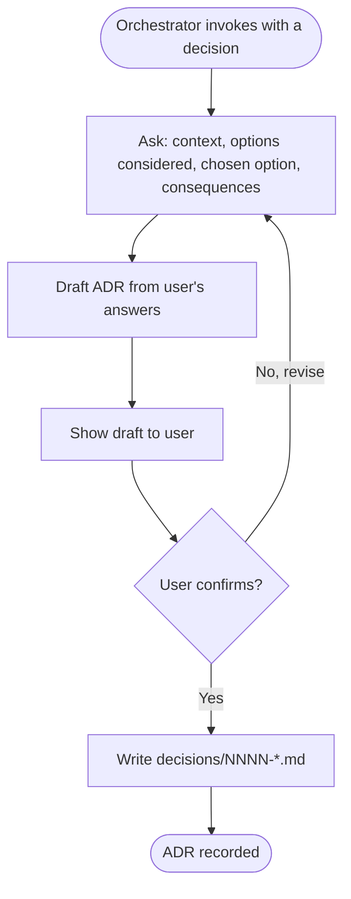

# Write ADR

Phase 4 of the discovery flow. Write **one** Architecture Decision Record per non-obvious choice. This skill is called once per decision - the orchestrator loops it.

## When to write an ADR

Write an ADR only when the decision is:

- **Non-obvious**: a reasonable engineer could have chosen differently.
- **Consequential**: it constrains future work (chosen store, chosen auth model, sync vs. async boundary, monorepo vs. polyrepo, etc.).
- **Durable**: it will still matter 6 months from now.

Do NOT write ADRs for trivial choices ("we use camelCase in JSON") or for choices already fully justified inside `architecture.md` or `data-model.md` prose.

## Preconditions

- The specific decision has been discussed and the user has confirmed it should be recorded.
- The orchestrator has told you the decision title and pointed at the source discussion (usually a line in `architecture.md` §7 or `data-model.md` §5).

## Numbering & filename

- ADRs live under `<cwd>/<slug>/decisions/`.
- Filename: `NNNN-kebab-case-title.md`, where `NNNN` is the next zero-padded 4-digit number.
- Never renumber existing ADRs. If a decision is superseded, write a **new** ADR that references and supersedes the old one; do not edit the old one's number.

## Flow



## Grill for the decision

Before drafting, ensure you have concrete answers for:

1. **Context** - What situation forced this decision? What was tried or considered informally?
2. **Options** - At least 2 alternatives, ideally 3. For each: one-line description.
3. **Decision** - Which option was chosen. Named clearly.
4. **Consequences** - What becomes easier, what becomes harder, what future work is now needed?
5. **Status** - Proposed, Accepted, Deprecated, Superseded. Default is Accepted when the user confirms.

If the user cannot articulate at least one alternative, push back - a decision with no considered alternative is a default, not a decision, and does not warrant an ADR.

## Output format

Write `decisions/NNNN-<slug>.md` with this structure:

```markdown
# NNNN. <Decision title>

**Status**: Proposed | Accepted | Deprecated | Superseded by [NNNN](./NNNN-*.md)
**Date**: <YYYY-MM-DD>
**Deciders**: <names or roles>
**Related**:
- [requirements.md](../requirements.md)
- [architecture.md](../architecture.md) §<section>
- [data-model.md](../data-model.md) §<section>

## Context

<2-5 sentences. What situation forced this decision? What constraints applied?
Reference specific initiatives from requirements.md or components from architecture.md
by their identifier (I1, I2, etc.).>

## Options considered

### Option 1: <name>
<2-4 sentences describing the option.>
**Pros**:
- <pro>
**Cons**:
- <con>

### Option 2: <name>
...

### Option 3: <name>
...

## Decision

We chose **Option N: <name>**.

<1-3 sentences on why this option won over the others - the deciding factor, not
a restatement of all the pros.>

## Consequences

**Positive**:
- <what becomes easier / possible>

**Negative**:
- <what becomes harder / constrained>

**Follow-up work**:
- <any new decisions or tasks this creates>
```

## Rules for this skill

- ONE decision per ADR. If the user tries to bundle "we chose Postgres AND we chose SQS", write two ADRs.
- Do NOT copy-paste large chunks of `architecture.md` into the ADR. Reference and link.
- Do NOT invent options the user did not consider. If they only considered one alternative, that's the ADR.
- Do NOT change an existing ADR's status to Superseded without also creating the superseding ADR in the same session.
- If the user asks to write an ADR for a decision that's already fully covered in `architecture.md` prose, ask whether they still want a formal ADR (some teams want them for auditability, some don't).
- **No informal ADR updates.** Once an ADR is written, do NOT append supplementary analysis about the same decision to `architecture.md`, `data-model.md`, `discussions/`, or any other file. If new information warrants a rethink, write a **superseding ADR** (with `Status: Accepted` and a `Supersedes: NNNN` link) and mark the old one `Status: Superseded by NNNN`. The ADR file is the single source of truth for its decision.

## Handoff

After persisting, report the filename and its status to the orchestrator so it can update any indexes and continue with the next flagged decision (or wrap up Phase 4).
